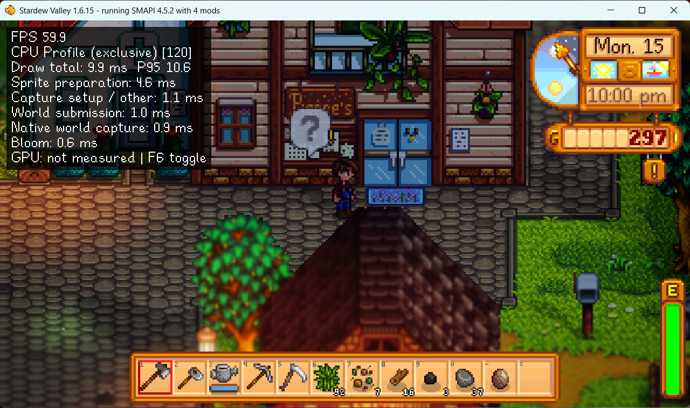
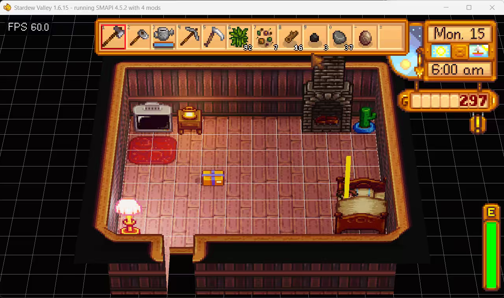
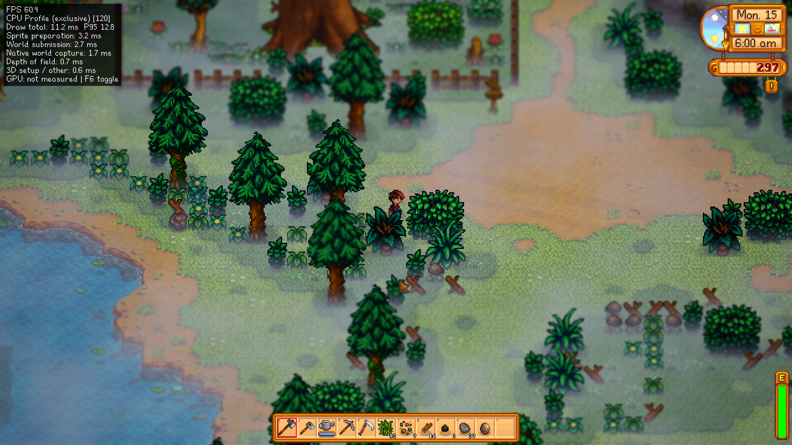
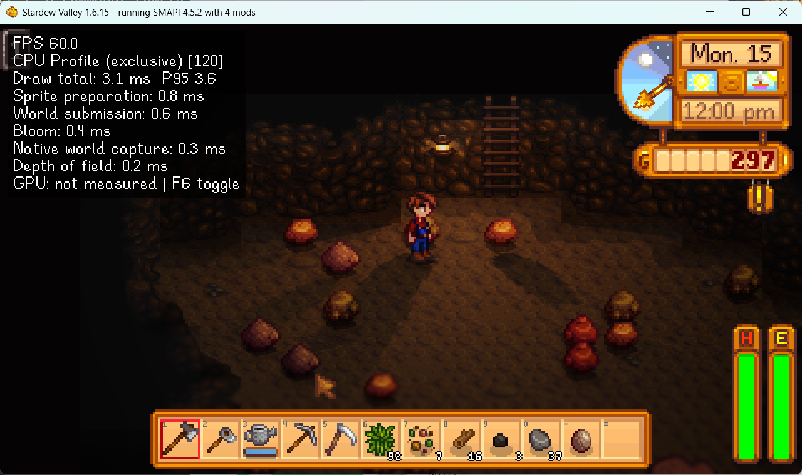
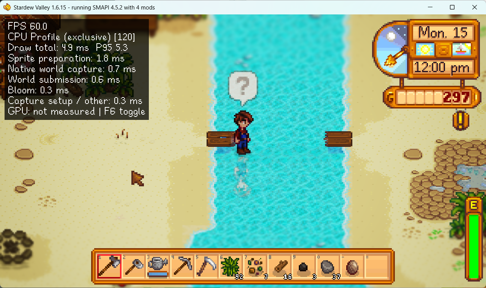
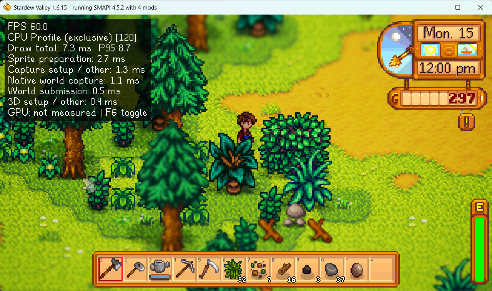
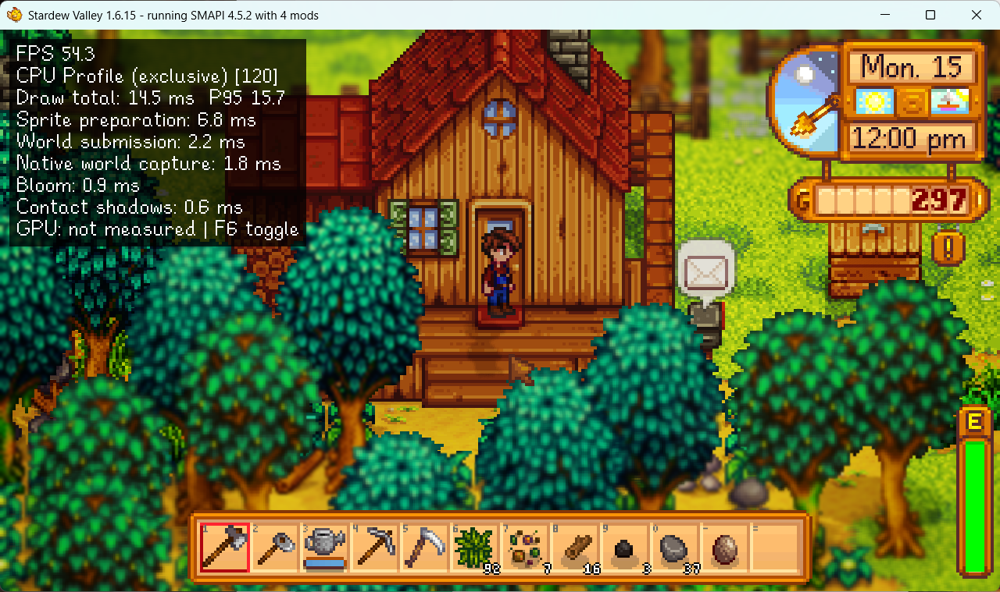

> [!WARNING]
> **🚧 早期测试阶段**
> **更新会很频繁，很多 Bug 还在修复，功能还在完善。**
>
> **🔓 所有功能稳定后会开源。**

---

<div align="center">

# 🌾 SDV-HD2D

**熟悉的像素世界，全新的光影舞台。**

把星露谷物语的像素美术，带进有光照、有阴影、有氛围的 3D 世界。

[](https://github.com/tiwe0/sdv-hd2d-release/releases)
[](https://github.com/tiwe0/sdv-hd2d-release/releases)
[](https://github.com/tiwe0/sdv-hd2d-release)
[](https://afdian.com/a/sdv-hd2d)

**[📸 游戏画面](#screenshots) · [📦 下载模组](https://github.com/tiwe0/sdv-hd2d-release/releases/latest) · [📖 安装指南](#installation-zh) · [🐛 问题反馈](https://github.com/tiwe0/sdv-hd2d-release/issues) · [⚡ 支持开发](https://afdian.com/a/sdv-hd2d)**

**简体中文** · [English](README.en.md)

</div>

---

<a id="screenshots"></a>

## 📸 游戏画面



<table>
<tr><td width="50%"><a href="images/preview-2.png"></a></td><td width="50%"><a href="images/preview-3.png"></a></td></tr>
<tr><td width="50%"><a href="images/preview-4.png"></a></td><td width="50%"><a href="images/preview-5.png"></a></td></tr>
<tr><td width="50%"><a href="images/preview-6.png"></a></td><td width="50%"><a href="images/preview-7.png"></a></td></tr>
</table>

## ✨ 当像素遇见光影

| ☀️ 阳光与阴影 | 🕯️ 点亮每一个夜晚 | 🌦️ 会呼吸的世界 |
|:---:|:---:|:---:|
| 太阳投影、云影与接触阴影 | 路灯、火光、动态光源与泛光 | 3D 雨雪、萤火虫与远景雾 |

| 🎥 换个角度看山谷 | 💧 材质与倒影 | 🎛️ 画面随你调 |
|:---:|:---:|:---:|
| 正交 / 透视镜头、旋转与景深 | HDR 光照、PBR 材质与水面倒影 | 游戏内设置，即时预览效果 |

> 🌱 **保留熟悉的玩法，让山谷多一个维度。** 仅改变渲染，不改玩法，不写存档。
>
> 🧪 **当前版本：0.9.0 公测版。** 已在 Windows 上测试；其他平台、联机与模组兼容性请查看下方说明。

---

<a id="guide-zh"></a>

## 📖 安装与使用

[环境要求](#requirements-zh) · [安装](#installation-zh) · [使用与设置](#usage-zh) · [问题反馈](#feedback-zh) · [常见问题](#faq-zh) · [已知限制](#limits-zh)

版本 **0.9.0 · 公测版**。

SDV-HD2D 把星露谷物语的画面变成八方旅人式的 HD-2D：游戏原有的像素美术立在有光照的 3D 舞台上，有阴影、发光的灯、泛光、景深、云影和 3D 天气。它只改渲染，不改玩法，也不写存档。

> [!CAUTION]
> **安装前必读**
>
> **SDV-HD2D 目前处于早期公测阶段（0.9.0），尚非稳定版本。可能出现画面异常、性能波动、交互偏移或模组冲突，请在了解以下限制后体验。**
>
> - **🖥️ 平台与依赖**：目前仅在 Windows 上开发和测试；请使用星露谷物语 1.6.15、SMAPI ≥ 4.5.2、StardewUI ≥ 0.6.1。Linux、macOS、多人联机及分屏均未测试。
> - **🧩 兼容性尚未充分验证**：其他光照或着色器模组可能冲突；自定义地图和自行绘制世界图像的模组可能出现细节缺失或错位。建议先在精简模组环境中测试。
> - **🎮 部分场景仍待验证**：钓鱼、战斗伤害数字、心事件与节日尚未充分实测；少数地形可能异常，透视或旋转镜头下的悬崖边、斜坡可能存在鼠标偏移。
> - **🛠️ 异常时先切回原版画面**：按 **F8** 关闭 3D 渲染进行对照；鼠标偏移时可按 **F9** 切回正交镜头。仍有问题时，退出游戏并暂时移除本模组。
> - **🐛 反馈请附复现信息**：前往 [Issues](https://github.com/tiwe0/sdv-hd2d-release/issues)，附上模组版本、地点、游戏时间、截图及 [SMAPI 日志链接](https://smapi.io/log)；地形问题可按 **F11** 查看格子坐标。

<a id="requirements-zh"></a>

### 1. 🧰 需要什么

| 项目 | 版本 | 从哪里下载 | 说明 |
|---|---|---|---|
| 星露谷物语（PC 版） | 1.6.15 | Steam / GOG | 必需 |
| SMAPI | 4.5.2 或更高 | [smapi.io](https://smapi.io) | 必需：模组加载器 |
| StardewUI（作者 focustense） | 0.6.1 或更高 | [Nexus Mods #28870](https://www.nexusmods.com/stardewvalley/mods/28870)、[GitHub Releases](https://github.com/focustense/StardewUI/releases) | 必需：设置页面用它绘制 |

- 没有其他依赖。SMAPI 自带的 Console Commands 和 Save Backup 保留即可。
- 在 Windows、SMAPI 4.5.2、StardewUI 0.6.1 上开发和测试；Linux、macOS 未测试。StardewUI 的社区分支（如 StardewUI Continued）也未测试。
- 缺少 StardewUI 时，SMAPI 会在启动时提示依赖缺失，并且不加载本模组。

<a id="installation-zh"></a>

### 2. 📦 安装

1. **安装 SMAPI**（已经装过就跳过）
   1. 先正常启动一次游戏，再退出。
   2. 从 [smapi.io](https://smapi.io) 下载 SMAPI，解压后运行 `install on Windows.bat`，按提示完成安装。
   3. Steam 用户：安装器最后会打印一行启动选项，形如 `"…\Stardew Valley\StardewModdingAPI.exe" %command%`。把整行（包括引号和 `%command%`）粘贴到 Steam：库 → 右键星露谷物语 → 属性 → 通用 → 启动选项。GOG、Xbox 等版本按 [smapi.io/install](https://smapi.io/install) 的说明操作。
2. **安装 StardewUI**：下载压缩包，解压到游戏目录的 `Mods` 文件夹，得到 `Mods/StardewUI/manifest.json`。
3. **安装 SDV-HD2D**：把 `SDV-HD2D-0.9.0.zip` 解压到 `Mods`，得到 `Mods/SDV-HD2D/manifest.json`。
4. **启动游戏**：Steam 里正常点「开始」即可，或直接运行游戏目录里的 `StardewModdingAPI.exe`。SMAPI 控制台里应能看到 `SDV-HD2D 0.9.0 by ivory` 和 `StardewUI 0.6.1`。

装好后的目录：

```text
Stardew Valley/
├─ StardewModdingAPI.exe
└─ Mods/
   ├─ ConsoleCommands/     （SMAPI 自带）
   ├─ SaveBackup/          （SMAPI 自带）
   ├─ StardewUI/
   │  └─ manifest.json
   └─ SDV-HD2D/
      ├─ manifest.json
      ├─ SDV-HD2D.dll
      ├─ assets/  data/  i18n/  docs/
      └─ config.json       （第一次启动后生成，保存你的设置）
```

**更新**：退出游戏，把新版压缩包解压到 `Mods` 覆盖即可。压缩包里没有 `config.json`，你的设置会保留。

**卸载**：删除 `Mods/SDV-HD2D`。存档不受影响。

<a id="usage-zh"></a>

### 3. 🎮 使用

#### 按键

| 按键 | 作用 |
|---|---|
| F10 | 打开或关闭 HD2D 设置（游戏菜单里「选项」旁的太阳图标也可以） |
| F8 | 开关 3D 画面，与原版对照 |
| F9 | 切换正交 / 透视镜头 |
| F11 | 格子网格：屏幕上每个地图格都标出坐标 `x,y`，报告问题时用 |
| F7 | 世界网格（调试用） |
| F6 | 性能面板：各渲染阶段的 CPU 和 GPU 耗时 |

#### 设置页面

按 F10 打开。共五个分区：

- **阳光与阴影**：统一 HDR 光照、PBR 材质、环境反射、水面倒影、白天/夜晚/室内亮度、太阳投影、云影、接触阴影。
- **局部光与动态光**：路灯、火光等点光源的强度、范围、反弹光和投影。
- **氛围**：远景雾、粒子（萤火虫、火星、雨雪）、地面薄雾。
- **HDR、泛光与景深**：曝光、泛光、调色、暗角、景深、渲染比例。
- **镜头与实体**：
  - 俯视角、水平旋转；
  - 透视镜头（关闭时为正交镜头，与原版画面布局一致）；
  - 视野角度（5–30°，只对透视镜头生效）；
  - 实体高度修正，以及「按当前俯视角设为原始像素高度」按钮；
  - 人物被挡住时淡出前方的遮挡物。

改动立即生效。「保存设置」只写入 `Mods/SDV-HD2D/config.json`，不会改动存档；「恢复默认」把整页设置恢复为默认值。界面文字跟随游戏语言（中文、英文）。

#### 镜头与鼠标

- 默认是正交镜头，俯视角 40°、水平旋转 0°：3D 画面与原版画面的位置完全重合。
- 打开透视镜头、加大视野角度或转动镜头，立体感更强，但能看到的地面更多，开销也更大。
- 鼠标指向的就是画面上看到的东西：点地面、作物、箱子或人物，作用的都是 3D 画面里光标下的那个。
  - 平地上，任何镜头都是精确的；
  - 透视或转动镜头时，在悬崖边和斜坡上可能偏一格；
  - 分屏时鼠标按原版的屏幕布局。

#### 性能

在开发机上（2560×1440 无边框全屏，垂直同步开），全部效果开启时：

- 默认镜头：所有测过的地点都是 60 FPS，最重的农场和夜晚的沙龙每帧 CPU 约 13 ms。
- 透视镜头、视野 12°：同样 60 FPS。
- 透视镜头、视野 30°：农场约 54 FPS，早晨的森林约 58 FPS，Town 和沙龙 60 FPS。

帧率上限由游戏自己的「垂直同步」选项决定（开启时等于显示器刷新率）。帧率不够时，依次尝试：

1. 调低「渲染比例」；
2. 关闭「太阳投影」或「点光投影阴影」；
3. 关闭「景深」；
4. 透视镜头时调小视野角度。

#### 设置文件

`Mods/SDV-HD2D/config.json` 在第一次启动时生成。设置页面覆盖了所有画面设置；游戏关闭时也可以直接编辑这个文件。另外几项：

- `ShowFrameRate`：左上角的 FPS 数字，默认开启，设为 `false` 关闭。
- `StageEnabled`：3D 画面总开关（等同 F8）。
- `DebugGridEnabled`、`DebugCellsEnabled`、`DebugGroupsEnabled`：调试叠加层，默认关闭。
- `AutoLoadSaveFolder`：仅开发用，普通启动不读取。

<a id="feedback-zh"></a>

### 4. 🐛 报告问题

- 按 F11 记下出问题的格子坐标 `x,y`，以及地点和游戏时间，最好附截图。
- 性能问题：按 F6 看各阶段耗时，或在 SMAPI 控制台输入 `hd2d_profile dump`，结果写到 `Mods/SDV-HD2D/.dev/screenshots/frame-profile.json`。
- 附上 SMAPI 日志：打开 [smapi.io/log](https://smapi.io/log)，上传 `%appdata%\StardewValley\ErrorLogs\SMAPI-latest.txt`，把生成的链接发给作者。
- 控制台命令：
  - `hd2d_shot [名字]`：截图到 `Mods/SDV-HD2D/.dev/screenshots`；
  - `hd2d_settings reset`：恢复默认设置，`hd2d_settings save` 保存；
  - `hd2d_stage`、`hd2d_cells`：同 F8、F11。

<a id="faq-zh"></a>

### 5. 💡 常见问题

- **启动时提示缺少 StardewUI**：按第 1 节安装 StardewUI，并确认 `Mods/StardewUI/manifest.json` 存在（不要多套一层文件夹）。
- **按 F10 没有设置页面**：StardewUI 没有加载。在 SMAPI 控制台或日志里搜索 `StardewUI` 和 `SDV-HD2D` 的报错。
- **画面变回原版的 2D**：可能误按了 F8，再按一次即可。夜间农场事件（女巫、仙子、陨石）和事件自带的特殊场景本来就保持原版画法。
- **鼠标偏了一格**：多半是在透视或转动的镜头下、悬崖边或斜坡上。切回正交镜头（F9，或在设置页关闭「透视镜头」）即可精确。
- **帧率低**：见「性能」一节。

<a id="limits-zh"></a>

### 6. 🚧 已知限制（公测）

- 钓鱼小游戏、战斗伤害数字、心事件和节日已经做成 3D，但还没在实际游玩中充分验证，遇到异常请反馈。
- 夜间农场事件和事件自带的特殊场景保持原版 2D；少数特殊光照情况会在那一帧使用原版光照。
- 少数地形位置从地图美术推导得还不够准确，例如森林和山区两道下面没有崖壁的小瀑布。
- 其他模组：
  - 修改美术素材的模组正常生效；
  - 修改地图的模组会得到通用场景，没有手工调整的细节；
  - 用自己方式绘制世界图像的模组，这些图像可能显得扁平或错位；
  - 自带光照或着色器的模组可能冲突；
  - 自己读取光标的模组仍按原版的屏幕布局。
- 多人联机和分屏未测试。


---

## 🗺️ 后续计划

### 优先完善

- [ ] **更好的配置 UI 交互**：优化设置分组、参数说明与操作反馈，让画面调节更直观，方便预览效果、保存设置和恢复默认值。
- [ ] **模组兼容框架（重点）**：提供统一的接入接口与适配配置，让其他模组作者能快速接入自定义地图、素材与场景；配套接入文档、示例和调试工具，降低兼容成本。
- [ ] **人工修复地形**：逐步校正从地图美术推导不准确的地形，完善场景细节。
- [ ] **不同季节的光照变化**：为春、夏、秋、冬调整阳光色调、强度与环境光，并完善与时段、天气的过渡。
- [ ] **镜头与交互修正**：改善透视、旋转镜头下悬崖边和斜坡处的鼠标定位与遮挡表现。
- [ ] **特殊场景验证**：补充钓鱼、战斗伤害数字、心事件与节日的实测，修复画面和交互问题。

### 后续探索与优化

- [ ] **性能与画质预设**：优化复杂场景和多光源下的开销，探索适合不同设备的画质预设。
- [ ] **模组兼容性**：逐步验证自定义地图、美术替换及其他渲染模组，整理兼容情况与推荐设置。
- [ ] **更多运行环境验证**：评估 Linux、macOS、多人联机与分屏的表现，根据测试结果确定适配范围。
- [ ] **开源准备**：所有功能稳定后公开源码，并整理构建说明与贡献指南。

计划会根据测试反馈调整；探索项的支持范围以实际验证结果为准。

## 🙏 致谢

感谢 **[SDV-Radiance](https://github.com/PHUICMT/SDV-Radiance)**。本项目使用了该模组的部分数据。

## 💜 为山谷的下一束光发电

如果你喜欢 SDV-HD2D，欢迎通过爱发电支持后续开发与维护。感谢每一位体验、反馈和支持这个项目的玩家！

<div align="center">

<a href="https://afdian.com/a/sdv-hd2d"></a>

**[afdian.com/a/sdv-hd2d](https://afdian.com/a/sdv-hd2d)**

</div>
